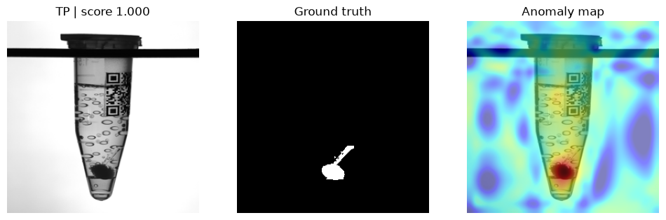
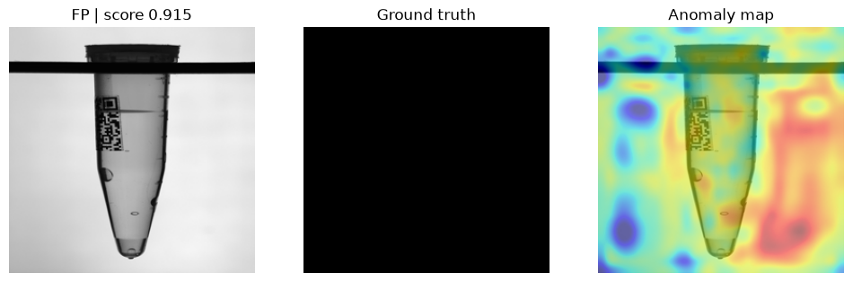

# Industrial Anomaly Detection on MVTec AD 2

Unsupervised defect detection and localization on the **MVTec AD 2 – Vial** category using **PatchCore** (PyTorch / anomalib), with **ONNX export** and a **CPU latency benchmark**.



**At a glance**
- **Detection:** image AUROC **0.934**, pixel AU-PRO **0.837** on the public test set (71 images).
- **Decisions:** all 53 defective tubes caught (zero escapes) at a **56% false reject rate** on good tubes. Lighting changes cause most of the false rejects.
- **Deployment:** ONNX Runtime runs **1.56× faster** than PyTorch on a laptop CPU (280 ms / image), with outputs matching to ~10⁻⁶.

## Why unsupervised?

On a real production line, defects are rare and new defect types appear without warning. Collecting and labelling enough defect examples for a supervised classifier is slow and never complete.

Unsupervised anomaly detection avoids that problem. The model learns **only from defect-free parts** and flags anything that deviates from them. That matches how inspection data is actually available in manufacturing.

## Dataset

[MVTec AD 2](https://www.mvtec.com/research-teaching/datasets/mvtec-ad-2) was released in 2025 because the original MVTec AD benchmark has saturated: top methods differ by less than one percentage point. AD 2 adds harder cases, including transparent objects, lighting changes and very small defects.

This project uses the **Vial** category: semi-transparent plastic sample tubes with printed labels. Transparency, reflections and printed patterns make this category hard for rule-based inspection.

| Split | Used for |
|---|---|
| `train/good` | Training (defect-free images only) |
| `test_public/good` | Testing: 18 good images (5 physical tubes, each captured under several lighting conditions) |
| `test_public/bad` + `ground_truth` | Testing: 53 defective images with pixel masks |

The private test sets have no public labels, so they are not used.

## Method

- **Model:** PatchCore, using a pretrained WideResNet-50 backbone with `layer2` + `layer3` features.
- **How it works:** features from normal images are stored in a memory bank. A test patch's anomaly score is its distance to the nearest normal feature.
- **Coreset sampling ratio:** 1%. This keeps CPU training at about 10 minutes and makes inference faster.
- **Input size:** 256 × 256.
- **Reproducibility:** seed 42 (`seed_everything`).

## Results

### Detection and localization (public test set, 71 images)

| Metric | Value |
|---|---|
| Image AUROC | **0.934** |
| Pixel AUROC | 0.917 |
| Pixel AU-PRO | **0.837** |

These numbers come from the final checkpoint, evaluated with `src/evaluate.py` (seed 42) and saved in `reports/metrics.json`. `reports/baseline_metrics.json` holds the test metrics from an earlier training run (image AUROC 0.893, pixel AU-PRO 0.853). The gap shows how much results vary between runs (see [Limitations](#limitations)).

**What the metrics mean:**
- **Image AUROC** measures how well defective tubes are ranked above good ones. It doesn't depend on a threshold.
- **Pixel AUROC** scores every pixel independently. Because most pixels are background, it tends to be high.
- **AU-PRO** scores each defect region equally, so small defects count as much as large ones. It is the stricter localization metric used by MVTec.

**Note on comparability:** AU-PRO here uses anomalib's default false-positive limit and is computed on the **public** test set. The MVTec AD 2 paper reports AU-PRO at a stricter limit on the **private** test set, so these numbers are **not directly comparable** to the published benchmark.

### Decisions at anomalib's default threshold

| Outcome | Count | Meaning |
|---|---|---|
| Defects caught (TP) | 53 / 53 | **Zero escapes** |
| Good tubes rejected (FP) | 10 / 18 | **56% false reject rate** |
| Good tubes passed (TN) | 8 / 18 | |

The model catches every defective tube, but rejects more than half of the good ones. Image AUROC of 0.93 shows the features separate good and defective tubes well overall. The false rejects have two main causes: the automatically chosen threshold, and the model’s sensitivity to lighting changes. See [Example cases](#example-cases).

| Lighting (good images) | False rejects |
|---|---|
| Regular | 1 / 3 |
| Non-standard (shifted, over-/underexposed) | 9 / 15 |

**Why F1 is not the headline metric:** image F1 at this threshold is 0.914 (precision 0.84, recall 1.00). It looks high only because 53 of the 71 test images are defective. The false reject rate shows the real cost on good parts.

In production, the operating point would be chosen explicitly, based on the cost of an escape (a defect reaching the customer) versus a false reject (yield loss). See [Limitations](#limitations).

### Example cases

Each figure shows the input image, the ground-truth mask and the anomaly map overlay.

| Correct detection (TP) | False alarm (FP) |
|---|---|
|  |  |

The TP example was also captured under shifted lighting: the defect is detected despite the illumination change, while the FP shows that lighting alone can trigger a false alarm.

**Observations:**
- **Correct detections:** the anomaly map concentrates on the annotated defect region.
- **Most false alarms come from lighting changes.** 9 of the 10 false alarms, including the three highest-scoring ones, are good tubes captured under non-standard lighting (underexposed, overexposed, shifted). One good tube under regular lighting (`003_regular`) is also rejected, so lighting is not the only cause. The anomaly map activates on the background and label region rather than on a specific defect, and the underexposed tube scores highest (0.915). PatchCore treats illumination changes as anomalies, which is the robustness challenge MVTec AD 2 was designed to expose.
- **Resolution:** at 256 × 256, very small defects cover only a few pixels, which limits localization precision.

## Deployment: ONNX export and CPU benchmark

The trained model was exported to **ONNX** (opset 18) and run with **ONNX Runtime** on CPU. Both runtimes received identical inputs and the same thread count (4).

| Runtime | CPU latency (ms / image) |
|---|---|
| PyTorch | 437.4 |
| ONNX Runtime | **280.3** |
| **Speedup** | **1.56×** |

**Output check:** maximum difference between PyTorch and ONNX outputs across 40 test images (20 good, 20 defective):
- anomaly score: 3.2 × 10⁻⁶
- anomaly map: 7.9 × 10⁻⁶

The exported model gives the same results as the PyTorch model.

**Benchmark notes:**
- The exported model has a **fixed batch size of 2**. Latency is reported as batch time ÷ 2.
- Measured on a single laptop CPU (Intel Core i5-1235U, 10 cores, 8 GB RAM), 4 threads, after 3 warm-up runs.
- The exported model contains anomalib's built-in threshold in `pred_label`. A deployment with a different operating point should apply its own threshold to `pred_score` instead.

## Project structure

```
├── configs/patchcore.yaml     # data paths, model and export settings
├── src/
│   ├── config.py              # YAML loader
│   ├── data.py                # anomalib Folder datamodule for MVTec AD 2
│   ├── model.py               # shared PatchCore builder (with AU-PRO evaluator)
│   ├── train.py               # training + test metrics
│   ├── evaluate.py            # metrics, per-image predictions, case figures
│   ├── export_onnx.py         # ONNX export
│   └── benchmark.py           # PyTorch vs ONNX Runtime: output check + latency
└── reports/
    ├── baseline_metrics.json  # test metrics from an earlier training run
    ├── metrics.json           # final reported metrics
    ├── case_counts.json
    ├── per_image_predictions.csv
    ├── benchmark.json
    └── figures/
```

## How to run

1. Download the **Vial** category from the [MVTec AD 2 page](https://www.mvtec.com/research-teaching/datasets/mvtec-ad-2), then set `data.root` in `configs/patchcore.yaml`.
2. Run:

```bash
pip install -r requirements.txt

python -m src.train          # train PatchCore and report test metrics
python -m src.evaluate       # metrics, per-image predictions, case figures
python -m src.export_onnx    # export to ONNX
python -m src.benchmark      # PyTorch vs ONNX Runtime latency + output check
```

**Windows note:** `num_workers: 0` and `OPENBLAS_NUM_THREADS=1` avoid DataLoader and OpenBLAS memory crashes.

## Limitations

- **Small good-image test set:** the 18 good test images come from only 5 physical tubes, so the false reject rate has wide uncertainty.
- **Lighting sensitivity:** good tubes captured under non-standard lighting are often flagged as anomalous. The training set does not cover enough illumination variation for PatchCore to treat it as normal.
- **Threshold:** the threshold is anomalib's automatic choice, partly based on a validation split drawn from the test set. Across unseeded runs, the false reject rate varied between 55% and 72%, while defect detection stayed at 52–53 of 53.
- **Run-to-run variation:** image AUROC was 0.893 in an earlier training run and 0.934 in the final run. Reporting mean ± std over several seeds is a next step.
- **Single category and public test set only:** no evaluation-server submission.
- **Resolution:** the 256 × 256 input limits detection of very small defects.
- **Fixed ONNX batch size:** the exported model accepts batches of exactly 2.

## Next steps

- **Lighting robustness:** brightness/contrast augmentation or normalization, evaluated separately on regular vs shifted lighting.
- **Threshold selection on `validation/good`:** choose the operating point explicitly to trade off escape rate against false reject rate.
- **Second category (Sheet Metal):** test the same pipeline on reflective metal surfaces under varied lighting.
- **Higher resolution or tiling:** improve detection of small defects.
- **Evaluation server:** submit to the official MVTec AD 2 server for comparable AU-PRO.
- **Deployment:** dynamic batch export, plus a FastAPI inference service with heatmap output in Docker.

## Acknowledgements and license

- **Dataset:** MVTec AD 2 by MVTec Software GmbH, licensed under [CC BY-NC-SA 4.0](https://creativecommons.org/licenses/by-nc-sa/4.0/). Images in `reports/figures/` are derived from this dataset. The dataset is not redistributed in this repository.
  > Heckler-Kram, L., Neudeck, J.-H., Scheler, U., König, R., Steger, C. *The MVTec AD 2 Dataset: Advanced Scenarios for Unsupervised Anomaly Detection.* International Journal of Computer Vision 134(4), 2026.
- **PatchCore implementation:** [anomalib](https://github.com/open-edge-platform/anomalib).